<div align="center">

# Bayesian Credit

### A shadow lending engine — contextual Thompson Sampling for credit decisions that learn

[](https://github.com/mistiusiu/bayesian-credit/actions/workflows/ci.yml)
[](core/pyproject.toml)
[](api/)
[](frontend/)
[](scripts/verify.sh)
[](LICENSE.md)

**Contextual Multi-Armed Bandits in Bayesian Sequential Decision-Making in Credit Risk Modeling**
Misati Randy Nyambane · BSc Data Science & Analytics · United States International University – Africa · DSA4900

*Traditional credit models answer "will this borrower default?". This system answers the question a lender actually has:*
***"given what we know right now, how much should we lend, at what price — and how should that policy change as evidence arrives?"***

</div>

---

## The idea in one picture

Credit risk is reframed from a static prediction problem into an **adaptive Bayesian policy-optimisation problem**. Every borrower passes through a closed loop: risk is estimated hierarchically, borrower states are propagated through a Markov chain, a risk-adjusted reward is formed, a lending policy (amount × rate × term) is chosen by Thompson Sampling, and the delayed, partial feedback that loans produce over years is fed back into the posteriors. A **PSI Sentinel** watches the loop and trips a circuit breaker when the population drifts; a **shadow lending engine** runs alongside the historical policy and prices the roads not taken.

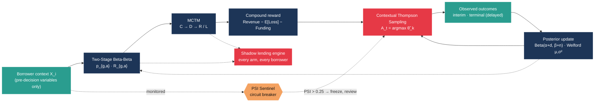

---

## What it does on real data — in 77 seconds

`python scripts/run_pipeline.py --source lending_club --max-rows 300000 --max-loans 50000` — 300 k random Lending Club loans (2007–2018), models fitted on issues before 2015, **50 k borrowers replayed month by month 2015 → 2018 with real delayed feedback**, six policies, one laptop core, 2.1 GB peak RSS.

<table>
<tr>
<td align="center"><b>0.667</b><br/><sub>ROC-AUC, elapsed-term hold-out (n = 49 k)</sub></td>
<td align="center"><b>0.031</b><br/><sub>expected calibration error</sub></td>
<td align="center"><b>$86 M vs $30 M</b><br/><sub>Thompson vs historical policy, cumulative expected reward</sub></td>
<td align="center"><b>$1.4 k vs $2.6 k</b><br/><sub>average regret per decision</sub></td>
</tr>
<tr>
<td align="center"><b>p<sub>DL</sub> = 0.243</b><br/><sub>delinquent → loss, estimated from 1.66 M transitions</sub></td>
<td align="center"><b>1 trip</b><br/><sub>PSI 0.256 on <code>revol_util</code>, 2017-12 → human review</sub></td>
<td align="center"><b>bit-identical</b><br/><sub>worker killed mid-run, resumed from checkpoint</sub></td>
<td align="center"><b>6.6 k decisions/s</b><br/><sub>49 s for 300 k decisions</sub></td>
</tr>
</table>

### Policies learn; the historical policy does not

Cumulative expected reward under the hindsight yardstick, in USD millions — series in order: **Thompson** (red), **ε-greedy** (orange), **UCB1** (teal), random (grey), historical (navy). Thompson Sampling, ε-greedy and UCB1 separate from the reference policy within the first year and keep separating; random lending is worth more than the historical policy only because the model is risk-neutral and the historical book is conservative.

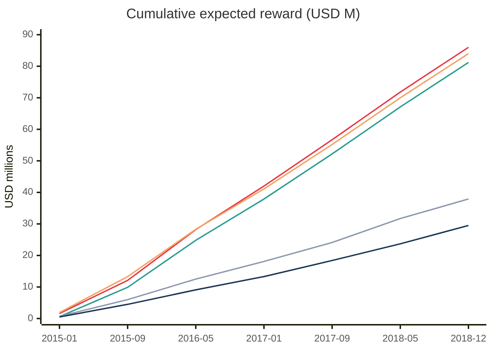

Cumulative pseudo-regret against the per-group oracle — **Thompson** (red), **Thompson with σ²/n** (orange), historical (teal), random (grey). The bandits' curves bend; the historical and random policies' do not.

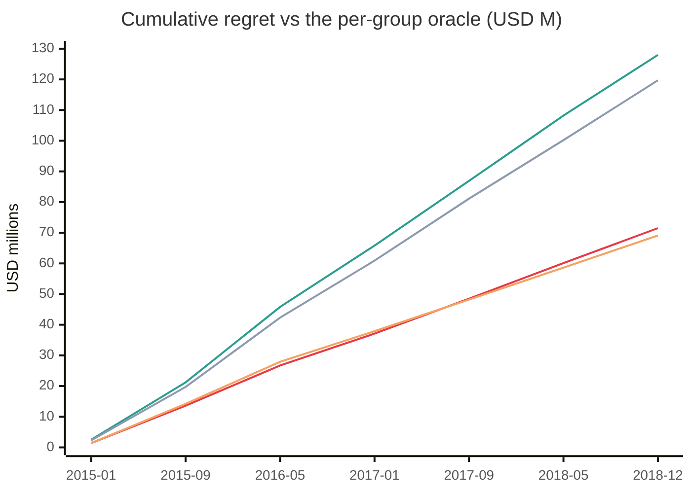

### The Sentinel catches a drift the model never saw

Aggregate PSI of the monitored pre-decision features against the pre-2015 reference window. It climbs through 2017 as Lending Club's borrower mix changes, crosses the 0.10 watch band in mid-2017 and trips the 0.25 breaker in December 2017; the policies freeze on their champion snapshot, a review is opened, and after acknowledgement the reference is re-based and the PSI falls back to zero.

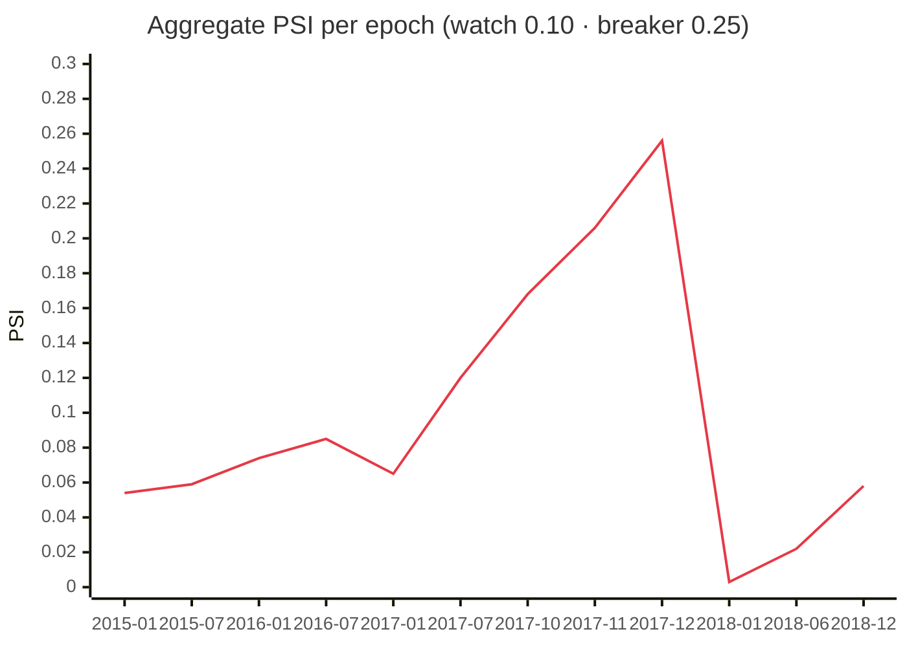

### Default risk is heterogeneous — and the hierarchy knows it

Posterior default probability by Lending Club grade (data-weighted mean over the groups of each grade, 76 groups, 1 657 leaves). The same borrowers, under the **shadow engine's** counterfactual policies, are repriced within ±5 points of their sub-grade reference rate — never blindly at the top of the grid.

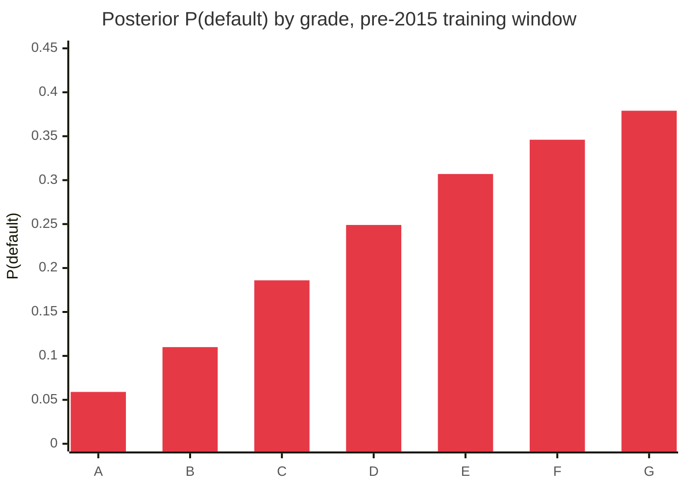

> **Read the counterfactual numbers as model quantities.** The shadow engine reports a +419 % expected-profit uplift over the historical book, decomposed as *repricing only* +128 % → *+ resizing* +282 % → *+ term choice* +419 %, and a risk-appetite sweep (λ = 1: +343 %, 29 % 36-month, mean amount $21 k). There is no take-up or adverse-selection term beyond the within-group policy effect, so most of the remaining uplift is larger exposures on borrowers the model believes are safe. The decomposition and the λ sweep exist precisely so that this is visible rather than hidden — see [`docs/SIMULATION.md` §10](docs/SIMULATION.md).

---

## The mathematics, and where it lives

Every equation in §3.3 of the proposal is implemented once, tested, and mapped in [`docs/MATH.md`](docs/MATH.md).

| Component | Model | Code |
|---|---|---|
| **Stage 1 — default** | $p_{g,a}\mid D \sim \mathrm{Beta}(\alpha_{g,a}+d,\ \beta_{g,a}+n)$ with priors built top-down $p_0 \to p_g \to p_{g,a}$; leaf prior mean tilted by a within-group policy effect $\sigma\!\big(\mathrm{logit}\,m_g + \beta\cdot(x_{g,a}-\bar x_g)\big)$ | `models/hierarchical.py`, `models/policy_effect.py` |
| **Stage 2 — recovery** | $R_{g,a}\mid D{=}1 \sim \mathrm{Beta}(\alpha^R,\beta^R)$, $\ \alpha^R=\mu\!\left(\tfrac{\mu(1-\mu)}{\sigma^2}-1\right)$, $\beta^R=(1-\mu)\!\left(\tfrac{\mu(1-\mu)}{\sigma^2}-1\right)$; fallback leaf → (group, term) → group → global | `models/recovery.py`, `models/beta.py` |
| **MCTM** | $S=\{C,D,R,L\}$, $\pi_t=\pi_0P^t$, $P(\text{Default},t)=\pi_D(t)+\pi_L(t)$, absorption $B=(I-Q)^{-1}R$ | `models/mctm.py`, `data/panel.py` |
| **Reward** | $R_t=\text{Revenue}_t-\mathbb{E}[L_t]-\text{Funding}_t$, $\ \mathbb{E}[L_t]=L_t\,P(D\mid X,A_t)\,(1-\mathbb{E}[R\mid X,A_t])$; default *level* from the Beta posterior, *timing* from the MCTM, interest scaled by the realised share of scheduled interest ($\rho_{36}=0.82$, $\rho_{60}=0.72$) | `rewards/compound.py`, `rewards/realization.py` |
| **Bandit** | $\theta_k\sim\mathcal N(\mu_k,\sigma_k^2)$, $A_t=\arg\max_k\tilde\theta_k$, $\ \mu_k\leftarrow\mu_k+\tfrac{r_t-\mu_k}{n_k+1}$, $\ \sigma_k^2\leftarrow\tfrac{(n_k-1)\sigma_k^2+(r_t-\mu_k^{(t)})(r_t-\mu_k^{(t+1)})}{n_k}$, one arm set per borrower group | `bandits/arm_state.py`, `bandits/contextual.py` |
| **Sentinel** | $\mathrm{PSI}=\sum_i (a_i-e_i)\ln\tfrac{a_i}{e_i}$; < 0.10 normal · 0.10–0.25 watch · > 0.25 breaker | `monitoring/psi.py`, `monitoring/sentinel.py` |

### The hierarchy shares strength without flattening heterogeneity

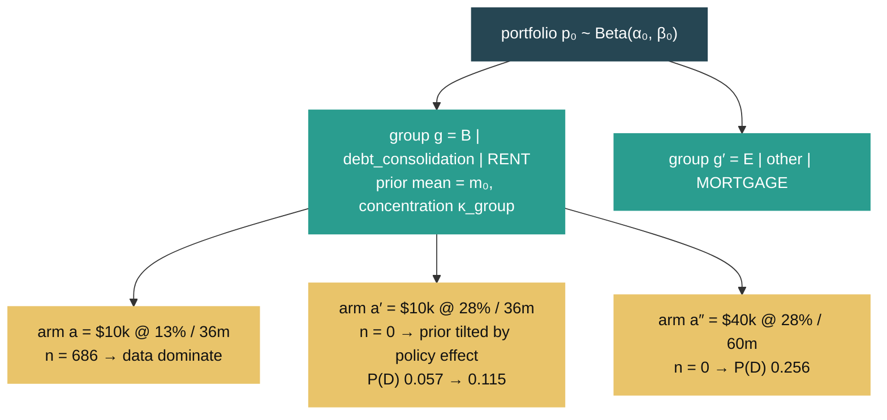

### Borrowers move through credit states — the chain fitted on 1.66 M real transitions

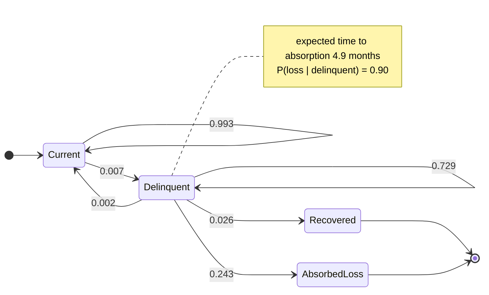

The proposal's matrix has structural zeros `P[C,R] = P[C,L] = 0` — a loan leaves *Current* only through *Delinquent* — and that is the default (`PROPOSAL`); an `EXTENDED` structure that allows pay-off `C → R` is one flag away.

### Feedback arrives late, and the replay respects that

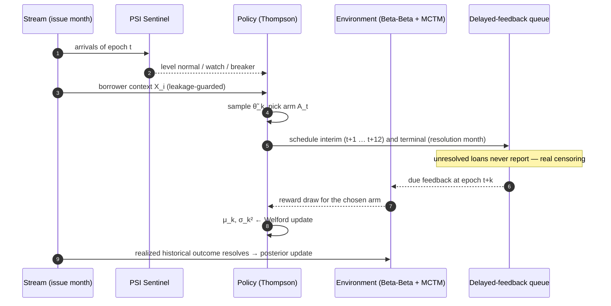

### Governance is a state machine, not a dashboard widget

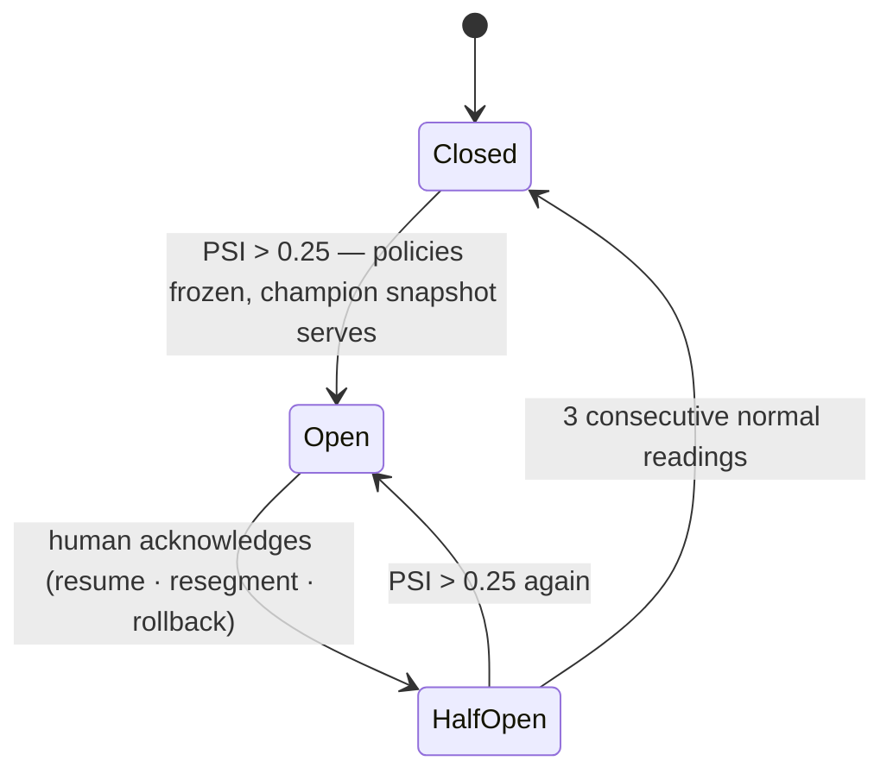

---

## Architecture

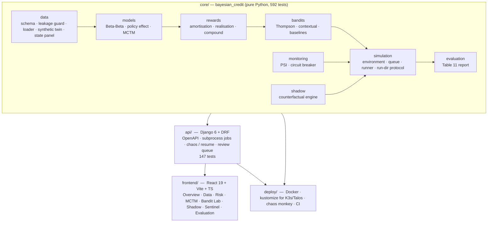

```
bayesian-credit/
├── core/bayesian_credit/      the modelling library (no Django inside)
├── api/                       Django REST API — run-directory file protocol, jobs, chaos/resume
├── frontend/                  the research console (mock mode by default, live mode via /api proxy)
├── deploy/                    Dockerfiles, docker-compose, kustomize manifests, chaos-monkey.sh
├── scripts/                   run_pipeline.py · verify.sh · download_data.sh · make_synthetic.py
└── docs/                      SPEC · MATH · DATA · SIMULATION · API · DEPLOY
```

### Data minimisation and leakage are enforced, not hoped for

Only the Appendix F Table 3 variables are loaded, and each carries its lifecycle stage. `LeakageGuard` makes it impossible to construct a `BorrowerContext` from interim or terminal columns — the API returns a `400 LeakageError` if you try.

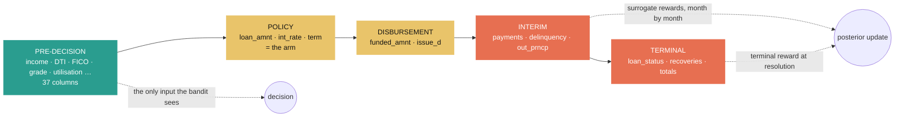

---

## The research console

Eight pages that make the loop visible: the hierarchy explorer with posterior means, 95 % HDIs and shrinkage weights; the MCTM heatmap and state-occupancy trajectories; a **Bandit Lab** with live cumulative reward and regret, arm-selection heatmaps, a chaos button and resume-from-checkpoint; a **Shadow Engine** that lays every arm out as a heatmap with guardrail eligibility hatched, the recommendation against the historical decision, and the portfolio uplift decomposition with a risk-appetite selector; a **Sentinel** page with PSI timelines, breaker state and the human-in-the-loop review queue; and the Table 11 evaluation grid.

| Page | What you see |
|---|---|
| Overview | the closed loop with live status, KPI tiles, the latest events |
| Data | ingestion (synthetic twin or Kaggle file), Table 3 stage table, feature distributions, loan browser |
| Risk Models | hierarchy explorer, policy-effect coefficients, calibration & ROC, recovery Beta, ρ by grade × term |
| MCTM | transition heatmap with counts, occupancy trajectories, P(default \| t), absorption probabilities |
| Bandit Lab | per-policy reward/regret, arm-selection heatmap, posterior histories, Simpson's-paradox panel, pause / resume / cancel / chaos |
| Shadow Engine | per-borrower arm heatmap, eligibility strip, recommendation vs history, portfolio decomposition & λ sweep |
| Sentinel | PSI per feature with threshold bands, breaker timeline, bucket tables, review queue |
| Evaluation | the nine Table 11 dimensions, runtime and resilience, JSON export |

---

## Quickstart

```bash
# clone + data
git clone https://github.com/mistiusiu/bayesian-credit.git && cd bayesian-credit
scripts/download_data.sh                 # Kaggle token in ~/.kaggle/access_token; or skip and use the synthetic twin

# backend
python3.14 -m venv .venv && . .venv/bin/activate
pip install -e "core[dev]" -r api/requirements.txt
python scripts/run_pipeline.py --source synthetic               # the whole loop on the synthetic twin, ~70 s
python scripts/run_pipeline.py --source lending_club --max-rows 300000   # on real data, ~80 s
cd api && python manage.py migrate && python manage.py demo && python manage.py runserver 8010   # http://localhost:8010/api/docs/

# console
cd frontend && pnpm install && pnpm dev                        # mock mode, http://localhost:5173
VITE_API_PROXY_TARGET=http://localhost:8010 pnpm dev:live      # against the live API

# everything, verified
make verify
```

Containers and the cluster:

```bash
docker compose -f deploy/docker/docker-compose.yml up --build   # console :8080, API :8000
kubectl apply -k deploy/k8s                                     # K3s on Talos — see docs/DEPLOY.md
deploy/chaos/chaos-monkey.sh --api http://localhost:8010 --simulation 1 --rounds 3   # kill the worker, watch it resume
```

---

## Documented modelling decisions

The proposal leaves a handful of details open. Each choice is a configuration default, not a hard-coded assumption (`core/bayesian_credit/config.py`), and each is written up in [`docs/SPEC.md` §7](docs/SPEC.md) and [`docs/MATH.md`](docs/MATH.md).

| Decision | Why |
|---|---|
| **Hierarchical priors** — child prior = parent posterior mean at concentration κ (fixed or Beta-binomial "auto") | sparse group × policy cells shrink to the portfolio instead of exploding |
| **Structured leaf prior** — offset logistic policy effect on rate, 60-month term, payment-to-income, log amount, centred within group, clipped at ±3 logit | an arm nobody in the group ever received is *not* as safe as the group average (Scott 2010, §2.2.1) |
| **Lending guardrails** — PTI ≤ 20 %, amount ≤ 50 % of income, total DTI ≤ 43 % (the Qualified-Mortgage ceiling), rate within ±5 pts of the sub-grade reference | the counterfactual stays inside a credit policy a lender would recognise |
| **Prepayment-aware reward** — expected interest and funding scaled by the realised share of scheduled interest, by grade × term | fully-paid 60-month loans earn 72 % of their scheduled interest, not 100 % |
| **Recovery by term** — fallback leaf → (group, term) → group → global | 60-month defaults recover 0.38 of principal vs 0.49 for 36-month |
| **Recovery definition** — `(total_rec_prncp + recoveries − fee) / funded_amnt` | makes `L·p·(1−E[R])` exactly the expected principal loss |
| **Null arm** — arm 0 is *decline* with reward 0 | the bandit decides *whether* to lend, not only how much |
| **Unbiased yardstick** — the hindsight oracle is fitted on loans whose term had elapsed | recent vintages' resolved loans are mostly early defaults |
| **Thompson posterior scale** — `N(μ_k, σ_k²)` exactly as written, `N(μ_k, σ_k²/n_k)` one flag away | the proposal's σ² converges to Var(r_k), so exploration never fully vanishes |
| **MCTM structure** — the proposal's structural zeros by default, `EXTENDED` optional | Lending Club is a snapshot; monthly paths are reconstructed with a documented heuristic |

---

## Documentation

| Document | Contents |
|---|---|
| [`docs/SPEC.md`](docs/SPEC.md) | the build specification: contracts, interfaces, API, decisions |
| [`docs/MATH.md`](docs/MATH.md) | all 26 equations of §3.3 → code, plus the assumptions S1–S6 / G1–G5 |
| [`docs/DATA.md`](docs/DATA.md) | Table 3 stages, parsing rules, outcome definitions, panel heuristic, synthetic twin calibration |
| [`docs/SIMULATION.md`](docs/SIMULATION.md) | epochs, feedback modes, oracle & regret, run-directory protocol, resume semantics, caveats |
| [`docs/API.md`](docs/API.md) | every endpoint with examples; `/api/docs/` serves the OpenAPI schema |
| [`docs/DEPLOY.md`](docs/DEPLOY.md) | images, compose, K3s/Talos, the Table 10 resilience experiments |

## Citing

```bibtex
@misc{nyambane2026bayesiancredit,
  author = {Nyambane, Misati Randy},
  title  = {Contextual Multi-Armed Bandits in Bayesian Sequential Decision-Making in Credit Risk Modeling},
  year   = {2026},
  school = {United States International University -- Africa},
  note   = {Research prototype: \url{https://github.com/mistiusiu/bayesian-credit}}
}
```

## Licence

PolyForm Noncommercial 1.0.0, dual-licensed — see [`LICENSE.md`](LICENSE.md) for commercial terms. The Lending Club data is CC0 and is not redistributed here.
